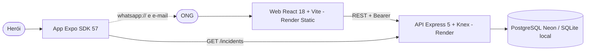

# Arquitetura — Be The Hero

## 1. C4

## 2. Contrato da API

| Método | Rota | Auth | Resposta |
|---|---|---|---|
| POST | /ongs | — | 201 `{ id }` |
| POST | /sessions | — | `{ name, token }` |
| GET | /profile | Bearer | casos da ONG |
| POST | /incidents | Bearer | 201 `{ id }` |
| GET | /incidents?page= | — | 5 casos + `X-Total-Count` |
| DELETE | /incidents/:id | Bearer (dona) | 204 / 403 / 404 |

## 3. Modelo de dados

| Tabela | Campos | Observação |
|---|---|---|
| ongs | id (16 hex), name, email, whatsapp (dígitos), city, uf, created_at | IDs antigos de 8 hex continuam válidos |
| incidents | id, title, description, value (decimal), ong_id → ongs.id, created_at | índice em ong_id; FK ativa no SQLite |

## 4. ADRs

| # | Decisão | Motivo | Alternativa |
|---|---|---|---|
| ADR-01 | Manter o ID como credencial, reforçado (64 bits, rate limit, JWT) | Preserva o produto e os IDs já emitidos | E-mail + senha — **decisão sua** |
| ADR-02 | Knex com better-sqlite3 local e pg em produção | Mesmas migrações nos dois; Render Free não guarda arquivo SQLite | Só SQLite |
| ADR-03 | zod no lugar de celebrate | Mensagens em português e mesma lib dos outros projetos | celebrate/Joi |
| ADR-04 | Vite + React Router 7 | CRA 3 descontinuado | Atualizar react-scripts |
| ADR-05 | Expo SDK 57 + React Navigation 7 | SDK 38 não roda no Expo Go atual | Manter SDK 38 |
